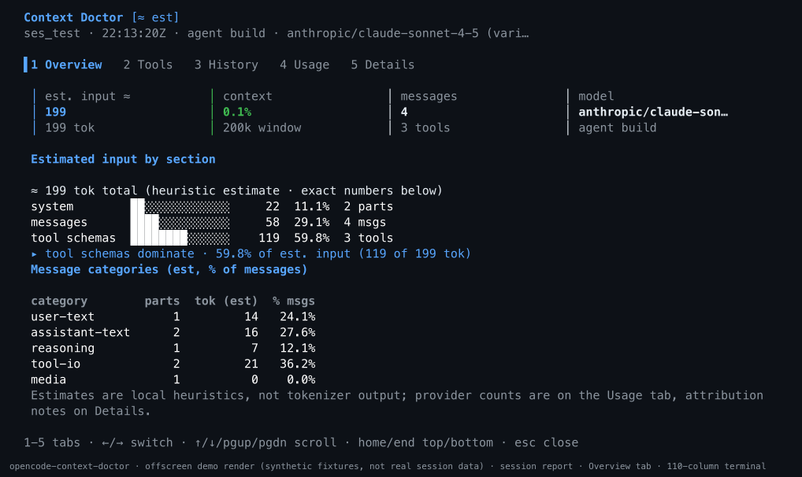
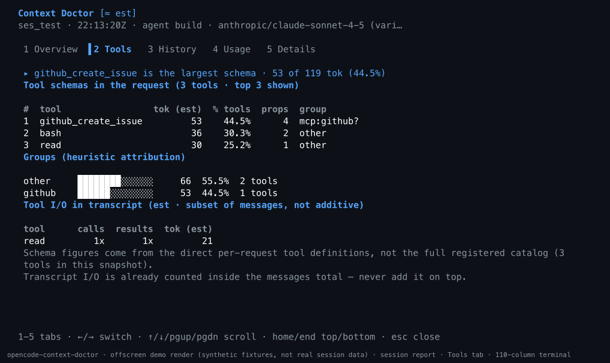
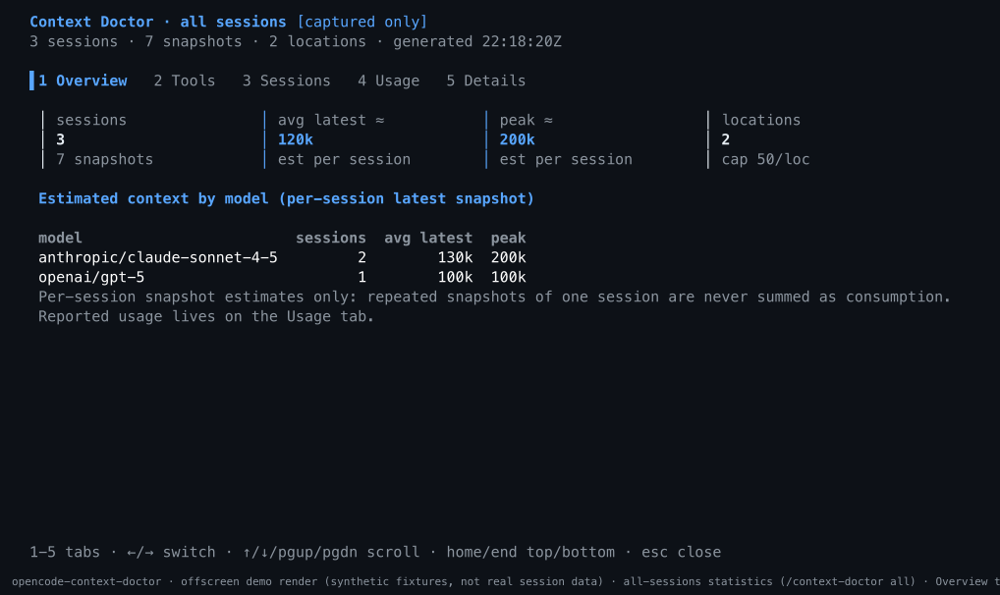
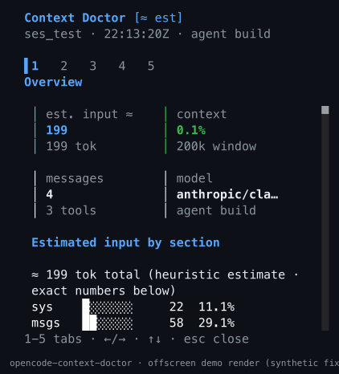

# opencode-context-doctor

[](https://github.com/briansunter/opencode-context-doctor/actions/workflows/ci.yml)

Observational context analytics for [OpenCode V2](https://opencode.ai/v2/docs/build/plugins/): a Claude-Doctor-style, detailed breakdown of what actually goes into your model requests, rendered as a tabbed terminal dashboard with `/context-doctor`.

- **Tabbed dashboard** (`Overview / Tools / History / Usage / Details`, switched with `1-5` or `←/→`): a compact KPI row (estimated input, context-window utilization, message count, model), colored block bars with human-readable numbers plus exact values, aligned ranked tables, and a dominant-consumer insight line. The full provenance/estimation caveats live on the Details tab instead of a wall of text.
- **Estimated** composition of each assembled request: system prompt, messages by role / part type / category (user text, assistant text, reasoning, tool I/O, media), and the **direct per-request tool schema snapshot**, ranked and grouped.
- **Per-tool transcript I/O** (call inputs vs result outputs) ranked separately from the static schema footprint.
- **Provider-reported token usage** (actual counts, never blended with the estimates): cumulative session totals and the latest completed request, plus context-window utilization.
- Snapshot history so you can watch the request grow across a session.
- **Disk persistence** (own SQLite database, worker-thread only): snapshots, error counts, and latest cumulative usage survive plugin reloads and server restarts. Bounded by age, session count, and a byte budget; aggregate metadata only, gzip-compressed.
- **All-sessions statistics** (`/context-doctor all`): a cross-location dashboard (Overview / Tools / Sessions / Usage / Details) - model/provider breakdown, per-tool totals, usage totals, and estimated-context distribution - computed from indexed metadata, with strict no-double-counting rules and an explicit "captured only" coverage badge.

Everything is read-only: the plugin observes assembled context, never modifies outgoing requests, never sends prompts, and never makes network calls.

```
Context Doctor [≈ est]
ses_a1b2c3d4 · 14:02:11Z · agent build · anthropic/claude-sonnet-4-5 (vari…

▌1 Overview   2 Tools   3 History   4 Usage   5 Details

 │ est. input ≈   │ context      │ messages    │ model
 │ 124.4k         │ 62.2%        │ 142         │ anthropic/c…
 │ 124,412 tok    │ 200k window  │ 37 tools    │ agent build

Estimated input by section

≈ 124,412 tok total (heuristic estimate · exact numbers below)
system        ██████░░░░░░░░     45k   36.3%  12 parts
messages      ██████████░░░░     68k   55.0%  142 msgs
tool schemas  █░░░░░░░░░░░░░     10k    8.4%  37 tools
▸ messages dominate · 55.0% of est. input (68,390 of 124,412 tok)
```

## Screenshots

These are offscreen renders of the real dashboard components — captured from the same isolated OpenTUI renderer the test suite asserts on, driven only by the synthetic test fixtures (`fixtures.ts`). No real session data appears in them; each image carries a caption saying so. The harness also asserts that the captured color-span frames contain exactly the same characters as the character frames the tests pin, so the images cannot drift from the real UI. Regenerate them with `bun run screenshots` (see [Development](#development)).

**Session report — Overview tab (wide terminal)**



**Session report — Tools tab (wide terminal)**



**All-sessions statistics — `/context-doctor all` (wide terminal)**



**Session report — Overview tab (narrow terminal)**



## Install

This plugin targets OpenCode 2.0 (`@opencode/plugin` 2.0.x, tested against 2.0.30 types). It is a standard V2 package plugin: the root export is the server plugin, `./tui` is the CLI plugin, `./rpc` is the shared typed RPC contract.

### Quick install (GitHub)

Install globally without manually cloning or configuring a local path:

```sh
opencode plugin add github:briansunter/opencode-context-doctor
```

Restart your OpenCode terminal client, send a normal message to capture context, then run `/context-doctor` (or `/context-doctor all` for cross-session statistics). Existing persisted snapshots remain available.

OpenCode V2 supports GitHub package specifications directly. This plugin is **not published to npm**; use the full `github:` specification, not the bare npm package name. The GitHub installation route has not yet been end-to-end verified for this plugin; local-path installation below has been verified.

For project-scoped configuration instead of a global installation:

```jsonc
{
  "$schema": "https://opencode.ai/config.json",
  "plugins": ["github:briansunter/opencode-context-doctor"]
}
```

Use either the GitHub package or a local checkout, not both. If switching from a local installation, remove only its existing entry from your server configuration and any explicit entry in `cli.json` to avoid loading duplicate copies. Keep your other plugins unchanged.

### Local checkout (development)

Clone this repository wherever you keep code, then load it by path:

```sh
git clone https://github.com/briansunter/opencode-context-doctor.git
cd opencode-context-doctor
bun install --frozen-lockfile
```

```jsonc
// opencode.jsonc (in the project whose OpenCode sessions you want to observe)
{
  "$schema": "https://opencode.ai/config.json",
  "plugins": ["/absolute/path/to/opencode-context-doctor"]
}
```

Relative paths from the config file also work (`"plugins": ["../opencode-context-doctor"]`). After editing the config, restart OpenCode; nothing else is configured at runtime. There is deliberately **no** automatic installation, download, or config mutation from inside the plugin.

### Remote servers

Install the server plugin on the machine running the OpenCode server that owns your sessions. Installing only on the client does not enable server-side capture. If your local TUI also needs an explicit client-side entry, add `"github:briansunter/opencode-context-doctor"` to the `plugins` array in [`cli.json`](https://opencode.ai/v2/docs/cli/plugins), preserving your other entries. The analytics RPC only answers where the server plugin runs.

### Updates and removal

For a GitHub installation:

```sh
opencode plugin update github:briansunter/opencode-context-doctor
# To uninstall instead:
opencode plugin remove github:briansunter/opencode-context-doctor
```

Restart the terminal client after updating. Remove any separately configured project or `cli.json` entry when uninstalling. Uninstalling the plugin does not delete its statistics database.

## Usage

Run `/context-doctor` in a session (or pick the command from the palette; outside a session you get a session picker).

Arguments (all optional, order-independent):

| Argument | Effect |
| --- | --- |
| `short` | dashboard on the Overview tab (compact default) |
| `detailed` | full dashboard (default; every tab is always available) |
| `tools` | open directly on the Tools tab |
| `all` (alias `stats`) | cross-location all-sessions dashboard instead of a session report |
| `N` (e.g. `5`) | show only the last N snapshot history rows on the History tab |

Examples: `/context-doctor`, `/context-doctor short`, `/context-doctor tools`, `/context-doctor all`, `/context-doctor detailed 10`.

The dashboard is a read-only dialog: `1-5` or `←/→` switch tabs, `↑/↓` / `pgup/pgdn` scroll, `home/end` (or `g`/`G`) jump to top/bottom, `esc` closes. All bindings live in a modal keymap layer that exists only while the dialog is mounted, so no host keys are touched otherwise. The layout adapts to narrow terminals (elided IDs, shorter bars, tiered tables) and never clips horizontally. The server plugin **emits** a `captured` RPC event (IDs and totals only) after each new snapshot so other clients can live-update; the shipped TUI is fetch-only and always pulls fresh data when the command runs.

### Locations, empty lists, and diagnostics

The server plugin runs **per location** (project directory) and its snapshot store is in-memory per instance. RPC calls are routed per location: the TUI targets the session's own location, but an anonymous CLI call such as

```
opencode api post /api/rpc/context-doctor/list --data '{"input":{}}'
```

is routed to the **server's default location** (not the caller's cwd). An empty `sessions:[]` from that call usually means "this instance has no captures", not "the hook is broken". Target the session's location explicitly:

```
opencode api post "/api/rpc/context-doctor/list?location%5Bdirectory%5D=%2Fpath%2Fto%2Fproject" --data '{"input":{}}'
```

Two bounded, content-free observability surfaces distinguish the cases:

- `context-doctor/diagnostics` (RPC): the instance's location directory, hook invocation count, captures stored, capture failures (closed-vocabulary code only, never error text), store counts, and a **persistence health block**: status (`active`/`degraded`/`disabled`/`pending`), the plugin's own state directory and database path, engine, flush/flush-failure counters, hydration counts, retention budgets, and database totals including the measured compression ratio. `hookInvocations: 0` on a busy machine = you are talking to a different location's instance; `captureFailures > 0` = the hook fires but analysis throws; both 0 with captures = healthy. A persistence failure never breaks analytics: the store keeps working from memory and the fixed error code shows up here.
- `report`'s `unknown_session` error now carries `reason` (`no_capture` = no context assembly observed in this instance yet; `hook_error` = capture attempts failed), plus `instanceDirectory` and the fixed-vocabulary error code. First-capture exceptions are always recorded, never silently dropped.

Snapshots are taken from the plugin's first observation onward. Since v0.2 they **persist across plugin reloads and server restarts** (see below): a reloaded instance hydrates its location's sessions from disk at startup, and a session's next primary model call re-captures and continues the history.

## Persistence (disk)

**What is stored.** Only aggregate, content-free data: the compressed `Analysis` snapshots (keys, sizes, counts, estimates), hook-error counts with their closed code vocabulary, per-session bookkeeping (first/last capture, activity, peak estimate), and each session's **latest cumulative** provider-reported usage (replace-not-sum, one row per session). No prompt, message, tool, or schema content - tests assert a marked secret never appears in the database bytes.

**Where.** The plugin's own state directory, never inside OpenCode's data directory and never its database:

```
$XDG_DATA_HOME/opencode-context-doctor/     (default: ~/.local/share/opencode-context-doctor/)
  context-doctor.db                          (SQLite, WAL; dir 0700, file 0600)
```

Uninstall = delete that one directory. Override with the `storageDirectory` option.

**Design (and why).** The OpenCode server runs plugins under Bun, whose SQLite drivers (`bun:sqlite`, `node:sqlite`) are **synchronous-only** - any statement on the main thread would block the server's event loop, i.e. the model-request critical path. All SQLite access therefore lives in a dedicated worker thread (`persist-worker.ts`):

- The context hook only calls `markDirty(sessionID)` - O(1) set bookkeeping, no serialization, no I/O (measured p50 ≈ 0.001 ms; see the benchmark below).
- Flushes are debounced (default 1.5 s), serial (one batch in flight), and coalesced per session: a burst of captures produces one transaction containing each session's latest state. Ordering is preserved; a failed batch restores its dirty marks and retries with the newest data.
- Crash consistency: WAL journal, `synchronous=NORMAL`, one transaction per flush (upserts + retention commit or roll back atomically).
- Concurrent-writer safety: every location instance runs its own worker against the same file; WAL plus a bounded busy timeout serializes overlapping writers, and each row's upsert is guarded by the session's *activity* timestamp - a stale flush from a pre-reload instance can never clobber newer rows. Usage columns additionally update only when the incoming cumulative event is at least as fresh.
- Hydration is async at startup and race-safe: live captures during hydration always win, restored snapshots re-derive the dedupe signature, and live cumulative usage stays ephemeral by design (the durable per-step fallback covers it after restart).
- Retention (own rows only): per-location session cap mirrored from the store, an age sweep (default 30 days), and a global compressed-payload byte budget (default 32 MB) - enforced in batched maintenance inside a flush transaction, never per capture; `VACUUM` runs at most daily.
- Failure model: worker spawn failure, unwritable directories, or corruption (the file is moved aside and recreated) degrade explicitly to a fixed code in diagnostics; analytics continue from memory.

**Not used, deliberately:** the SDK's `ctx.storage` KV would store payloads inside the server-managed storage (this plugin persists only its own data, in its own file), offers no compression or byte budgets, and cannot answer indexed cross-location aggregates.

## All-sessions statistics (`/context-doctor all`)

The dedicated `stats` RPC is the only cross-location surface (per-session `list`/`report` stay location-scoped). It answers from indexed metadata columns - compressed snapshot payloads are never touched - computed in the worker:

- session/snapshot counts, per-model breakdown (sessions, avg/peak/sum of **latest** per-session context estimates),
- usage totals: the sum of each session's **latest cumulative** `session.usage.updated` value (never the sum of repeated events; sessions never observed live contribute nothing),
- per-tool schema and transcript-I/O totals aggregated from each session's **latest retained snapshot only** - repeated snapshots of one session are never summed as token consumption,
- newest sessions and per-location summaries (bounded top-N).

Coverage is labeled honestly: "all sessions" means every session captured by this plugin on this host while persistence was enabled, within its retention budgets - not a complete history of OpenCode sessions.

## What is measured vs estimated (important)

**Estimated** numbers are produced locally by character-ratio heuristics (~4 chars/token for whitespace-delimited scripts, ~1.5 for CJK; JSON estimated from its serialized length). No tokenizer is embedded, downloaded, or called, and no claim of tokenizer-exact accuracy is made - not for Claude, GPT, or any other model. Estimates are directional only; no specific accuracy figure is claimed.

**Reported** numbers come from the provider via OpenCode:

- `session.usage.updated` events carry **cumulative session totals**. A newer value **replaces** the previous one (they are never summed), and the live value is **ephemeral** for per-session reports - it exists only while the plugin is loaded (the latest cumulative value is also persisted for the all-sessions aggregate; restored rows never feed back into per-session reports).
- The durable fallback **sums per-step assistant token records** from `session.context`, which survives plugin/server restarts.
- `session.usage.recorded` events (title/compaction requests) are shown as **auxiliary** and never added to the primary totals.
- The **latest completed request** is shown as raw token counts, separately from the estimates. No reported *utilization percentage* is computed: the latest reply may come from a different model than the current snapshot, and providers disagree on cache accounting, so a percentage could mislead. The only utilization figure shown is the **estimated** one (snapshot estimate over the model registry's context limit).

The plugin **never rescales estimates to match telemetry**. The two systems are displayed side by side, clearly labeled. Cumulative usage cannot calibrate a single-request snapshot (cache metrics overlap with provider-specific semantics, and image/opaque/native-compaction costs are unknown), so no "calibrated" mode exists.

## Privacy model

- The context hook is **observational**: it reads the assembled system/messages/tools/model and never writes to them. Tests assert the event object is byte-identical after observation.
- **No raw content is stored, emitted, rendered, or persisted**: analyses keep keys, sizes, counts, and estimates only - no prompt text, message text, tool descriptions, schema JSON, or tool inputs/outputs. Tests assert a marked secret never appears in any stored analysis, RPC payload, rendered line, or the on-disk database bytes.
- Stored hook and persistence errors use a **closed code vocabulary** (`analysis-failed`, `busy-timeout`, `db-corrupt`, ...); free-form error text could echo serialized content, so no error message, stack, or cause is logged or stored anywhere - only fixed codes.
- **No remote calls**: no tokenizers, no telemetry, no fetches. (The plugin process itself calls only local OpenCode server APIs: session context, model list, MCP server list.)
- **Disk persistence is aggregate-only and bounded**: gzip-compressed snapshot metadata in the plugin's own SQLite database (never OpenCode's), restricted to your user (0700/0600), capped by age (default 30 days), session count, and total bytes (default 32 MB). Cross-location statistics intentionally span every location this plugin has captured for your user; delete `$XDG_DATA_HOME/opencode-context-doctor` to erase everything.
- In-memory bounds are unchanged: at most N sessions (default 50) and M snapshots per session (default 20), with idle sweeping and LRU eviction mirrored to disk by the same budgets.

## Attribution limits (labeled in every report)

- **Tool schemas** come from the context hook's `tools` record - the exact per-request snapshot the model call carries - *not* from `ctx.tool.list()` (the full registered catalog). Code Mode catalog/schema text embedded in instructions or messages is counted under system/messages, so the tools total is **not** "all schema overhead".
- **MCP grouping is a heuristic**: effective tool ids are `namespace_tool`; a tool is attributed to an MCP server only when the id starts with `<server>_` for a configured server. Builtin and plugin tools (same shape) are grouped as `other`.
- **System prompt provenance is unavailable**: V2 system parts carry freeform metadata with no reliable per-file attribution, so AGENTS.md/instructions file costs cannot be split out. All parts are labeled unattributed rather than guessed.
- **Per-tool I/O** is keyed by the tool name recorded on transcript parts and is a *subset of the messages total* - do not add it on top.
- **Scope**: only the primary agent loop (`context` hook) is captured. Title, compaction, and transient `generate` requests are separate hooks and are not counted in snapshots (their token usage still appears in reported totals where the server attributes it).
- **Multi-location isolation**: each location's plugin instance sees every public server event but only accepts usage events that match its own location and a session it tracks; events without a verifiable location are ignored.

## Options

Pass options via the object plugin form:

```jsonc
{
  "plugins": [
    {
      "package": "opencode-context-doctor",
      "options": { "maxSessions": 100, "maxSnapshotsPerSession": 40, "mcpRefreshMs": 60000 }
    }
  ]
}
```

| Option | Default | Meaning |
| --- | --- | --- |
| `maxSessions` | 50 | sessions tracked per location (1-500, LRU-evicted) |
| `maxSnapshotsPerSession` | 20 | snapshot history per session (1-200, oldest dropped) |
| `sessionIdleMs` | 86400000 | idle sessions swept on the next write |
| `mcpRefreshMs` | 60000 | MCP server-name cache refresh (0 disables; grouping degrades to `other`) |
| `maxRankedTools` | 12 | tools shown in schema and I/O rankings (1-50) |
| `maxLargestMessages` | 5 | entries in the largest-messages list (1-20) |
| `persist` | true | disk persistence (set `false` to run memory-only) |
| `storageDirectory` | `$XDG_DATA_HOME/opencode-context-doctor` | state directory for the plugin's own database |
| `persistMaxAgeMs` | 2592000000 | retention: rows idle longer than this are swept (1h-365d) |
| `persistByteBudgetBytes` | 33554432 | retention: total compressed-payload budget (1MB-1GB) |
| `persistDebounceMs` | 1500 | write coalescing window (100ms-60s; never on the hook path) |

## Performance

Measured on this repository's benchmark (`bun run bench:persist`; Apple-silicon host, Bun 1.4.2, bun:sqlite) with a representative request - 175 messages, two system parts (~32k chars), 40 tool schemas (24 properties each) - and a fully loaded store (50 sessions x 20 snapshots):

- context hook: `store.record` p50 0.08 ms (pre-existing work); the persistence enqueue adds ~0.001 ms p50 and never touches disk, serialization, or SQLite on that path; enqueue cost is flat at 1 vs 20 retained snapshots (no O(history) work per capture).
- end-to-end flush of all 50 sessions x 20 snapshots: ~27-33 ms wall clock, entirely inside the worker thread, off the model-request path.
- footprint: 1,020 snapshots -> 6.8 MB raw JSON -> 277 KB compressed payloads (~25x measured compression; the aggregate payloads are highly repetitive), ~442 KB total database files.

These are single-run medians from the benchmark on one machine, not guarantees - run the benchmark yourself for current numbers. Deterministic regression tests additionally pin the structural claims: the hook returns before a blocked writer resolves, the queue stays bounded during a stalled writer, failed batches retry with the newest state, and the load-vs-live hydration race resolves in favor of live data.

## Architecture

```
index.ts            server plugin: context hook (observational), usage events (location-filtered),
                    typed RPC handlers, bounded snapshot store, persistence wiring
tui.tsx             CLI plugin: /context-doctor command, session picker, tabbed dashboard dialog
                    (KPIs, bars, tables), all-sessions dashboard, modal keymap layer,
                    session-location-scoped RPC calls
dashboard.ts        pure dashboard view model: layout tiers, elision, KPI rows, bars,
                    aligned tables, tab plans - renderer-free and fully tested
rpc.ts              typed RPC contract (JSON Schema, dependency-free)
analytics.ts        pure analysis of a hook event -> aggregate, content-free estimates
usage.ts            reported-usage accounting (cumulative replace-not-sum, auxiliary, durable sum)
store.ts            bounded in-memory snapshot store with LRU + idle sweep + hydration entry points
persist.ts          main-thread persistence manager: O(1) dirty marks, debounced serial flushes,
                    hydration merge (live wins), health, dispose drain
persist-worker.ts   worker thread owning all SQLite/gzip/fs work (WAL transactions, retention,
                    hydrate + global stats + health queries); no main-thread disk access
persist-protocol.ts message + payload contract between manager and worker (metadata only)
persist-stats.ts    pure cross-location aggregation with no-double-count rules (runs in the worker)
enrich.ts           reported section assembly (model registry window lookup, utilization)
format.ts           deterministic plain-text report/stats rendering (pure library, also used by smoke)
tui-render.test.tsx isolated-renderer tests: real OpenTUI frames, tab switching, responsive no-clip
tui-preview.tsx     offline preview harness (bun run preview) for visual verification;
                    writes character frames to the OS temp dir (or an explicit path argument)
scripts/screenshots.tsx  offscreen screenshot generator (bun run screenshots): renders the
                    real dashboards from synthetic fixtures and rasterizes docs/screenshots/*.png
persist.bench.ts    honest overhead benchmark (hook enqueue, flush latency, compression, size)
```

The TUI calls the server through `context.client.rpc(ContextDoctor)` with an explicit location: the **session's own location** (from session info) when reporting, because a session may live somewhere other than the TUI's current default location. The `stats` method answers from the shared per-user database, so any location's instance can serve it.

## Development

```sh
bun install
bun test          # 146 tests: pure analytics, bounded store, usage accounting, schema
                  # validation, server wiring with SDK-shaped mocks, TUI flow,
                  # dashboard view model (responsive fitting, exact math, privacy),
                  # isolated-renderer TUI frames (tabs, no-clip, wrap), and real
                  # worker+SQLite integration (roundtrip, isolation, retention,
                  # reload ownership, corruption, on-disk privacy)
                  # (runs with --preload @opentui/solid/preload so solid-js resolves
                  # to its reactive client build under Bun)
bun run typecheck # tsc --noEmit against @opencode/plugin 2.0.30 types
bun run smoke     # end-to-end harness incl. the reload-equivalent persistence roundtrip
bun run preview   # offline dashboards -> character frames at several widths (visual check;
                   # writes to the OS temp directory, or pass an explicit output path)
bun run screenshots    # regenerate docs/screenshots/*.png from synthetic fixtures (offscreen
                   # render of the real components; requires rsvg-convert or ImageMagick)
bun run bench:persist  # measured hook/flush/compression numbers (see Performance)
```

The integration tests pin the actual SDK response shapes (e.g. `model.list` and `mcp.list` return `{ location, data }` wrappers while `session.context` returns the bare array), so drift in the SDK surfaces as a compile error rather than a runtime surprise.

## Credits

Report presentation ideas (ranked tool costs, category split, bar charts, summary/detail modes) were inspired by [IgorWarzocha/Opencode-Context-Analysis-Plugin](https://github.com/IgorWarzocha/Opencode-Context-Analysis-Plugin). That project has **no license file**, so no source was copied; this implementation is original, uses native OpenCode 2.0 plugin/TUI/RPC APIs (no V1 hooks or install structure), and deliberately omits tokenizer downloads and telemetry rescaling.

## License

MIT
